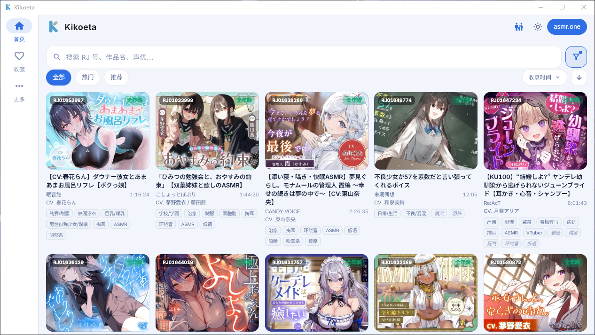
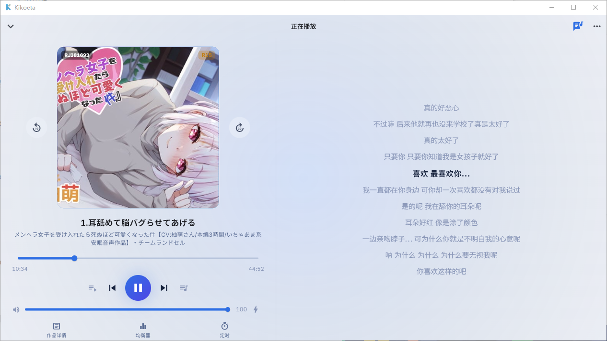
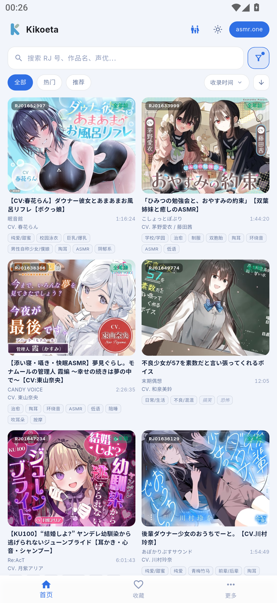
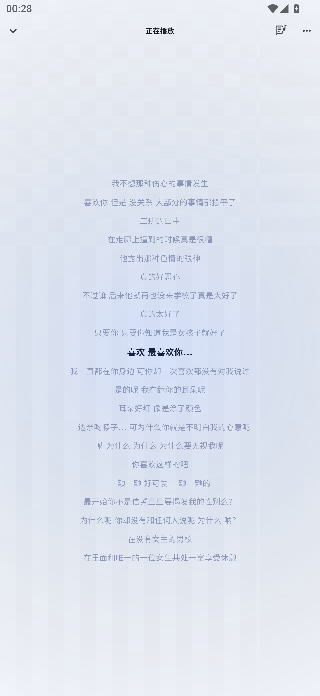
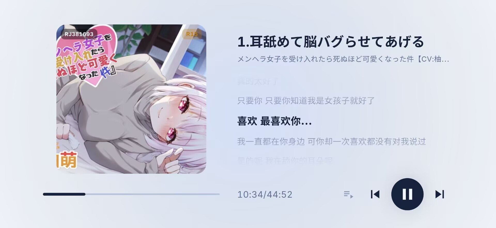
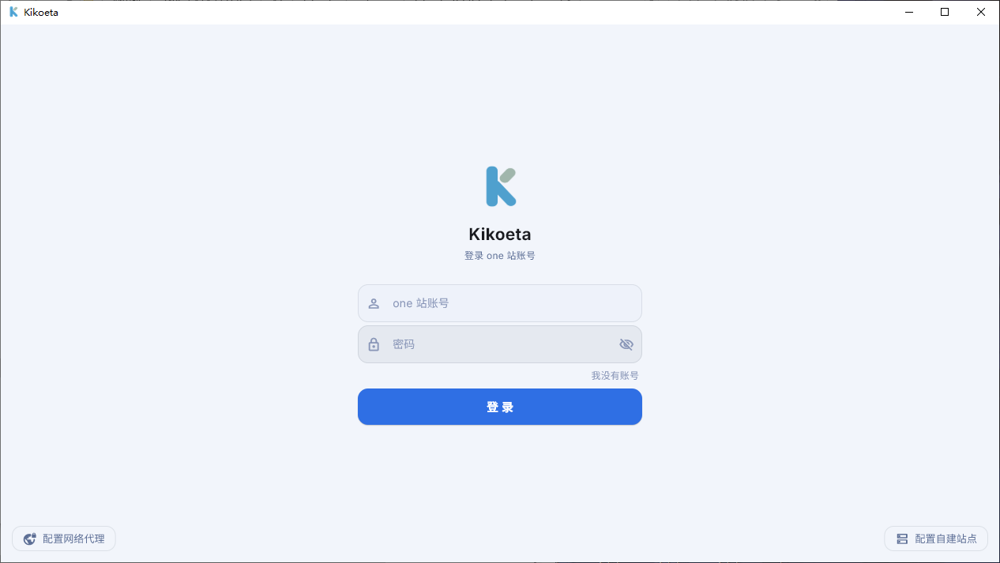
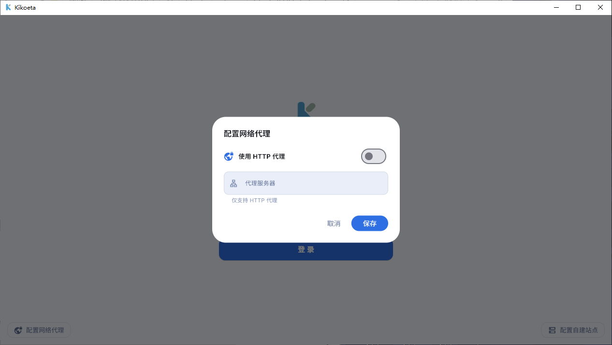
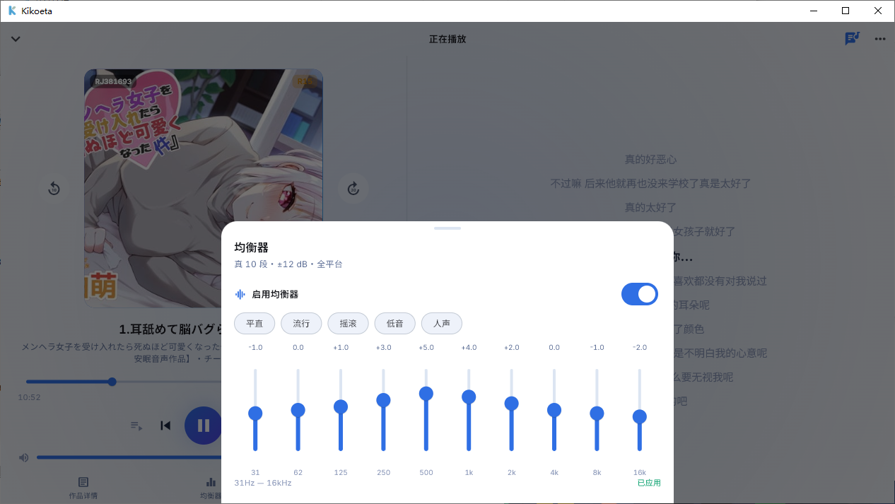
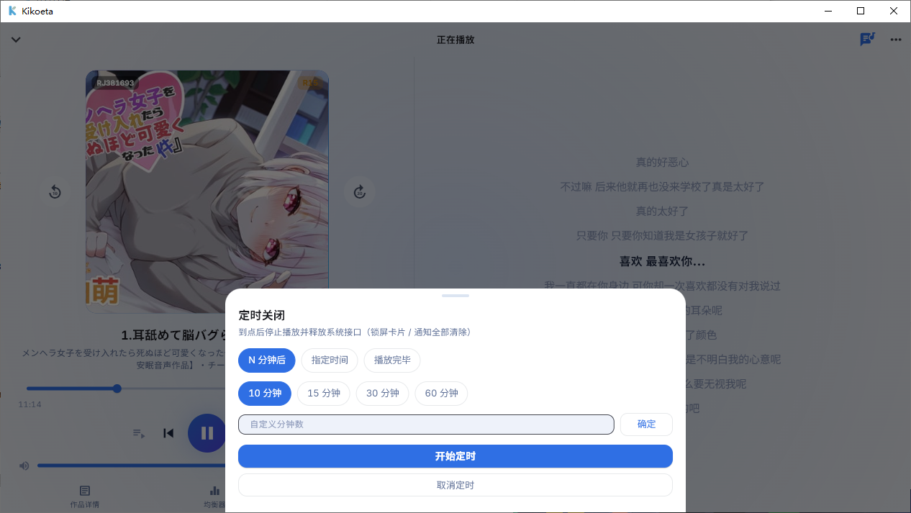
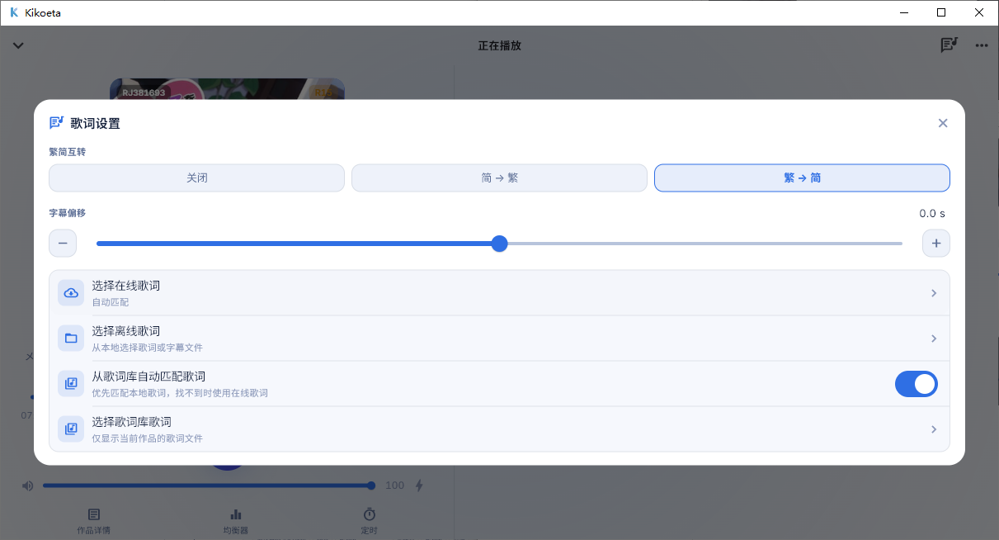

# Kikoeta

[简体中文](README.md) | [繁體中文](README.zh-Hant.md) | [English](README.en.md) | [日本語](README.ja.md) | [Русский](README.ru.md)

> An ASMR listening client. Browse and play works from asmr.one, DLsite Play, and self-hosted kikoeru-express servers on Windows and Android, with lyrics and local library management.

[](https://github.com/chenflxs/kikoeta/releases) [](LICENSE) [](https://flutter.dev/) [](https://www.rust-lang.org/) [](https://github.com/chenflxs/kikoeta/releases)

> [!WARNING]
> This is an unofficial personal project for learning and personal listening. Server APIs and their availability may change at any time. Please follow the rules of the services you use.

[Download](#download) · [Features](#features) · [Transcription and translation](#transcription-and-translation) · [Remote lyrics library](#remote-lyrics-library) · [Development](#development)

## Screenshots

### Desktop

| Home | Player |
| --- | --- |
|  |  |

### Android

<table>
  <tr>
    <th width="33%">Home</th>
    <th width="33%">Player artwork</th>
    <th width="33%">Player lyrics</th>
  </tr>
  <tr>
    <td></td>
    <td></td>
    <td></td>
  </tr>
</table>

#### Landscape player (phones / ultrawide displays only)



<details>
<summary>More screenshots: settings and playback tools</summary>

<table>
  <tr>
    <th width="50%">Account login and self-hosted servers</th>
    <th width="50%">HTTP proxy</th>
  </tr>
  <tr>
    <td></td>
    <td></td>
  </tr>
  <tr>
    <th>10-band equalizer</th>
    <th>Sleep timer</th>
  </tr>
  <tr>
    <td></td>
    <td></td>
  </tr>
</table>

<p align="center">
  <br>
  Quick lyrics settings
</p>

</details>

## Features

### Find something to listen to

- Paginated browsing and search by title, tag, circle, or voice actor, with popular and recommended works, sorting, age ratings, and subtitle filters.
- SFW mode, blacklist filtering, and search history. Copy an RJ ID to search for it directly.
- Switch between asmr.one, DLsite Play, and self-hosted kikoeru-express servers, with account sign-in and HTTP proxy support.

### Built for listening

- Track trees with audio format preferences, playback queues, saved progress, and attachment previews or external opening for images, text, and video.
- Playback modes, volume control, two levels of loudness boost, a 10-band equalizer, and a mini player.
- Automatic online lyrics matching, manual selection of local or online lyrics, timing offsets, and Simplified/Traditional Chinese conversion. Landscape mode can show playback controls and lyrics together.
- Sleep timers with a countdown, a scheduled time, or an end-of-playback option. The desktop app exits when the timer finishes; the mobile app stops playback.

### Local data and platform features

- Store favorites, playback and search history, playlists, blacklists, translation caches, and playback progress locally.
- Translate work titles and track names using Google, Microsoft Edge, DeepL, or an OpenAI-compatible translation service.
- Connect to an external [kikoeta-transl](https://github.com/chenflxs/kikoeta-transl) service. Select audio on a work's detail page to create transcription and translation tasks; completed LRC files are automatically imported into the local lyrics library.
- Windows: desktop lyrics with locking, adjustable font size and colors, plus system tray controls.
- Android: draggable and lockable floating lyrics, lock-screen and notification media controls, audio focus handling, pause on headphone disconnect, and battery optimization settings.

## Supported platforms

| Platform | Status | Release artifact |
| --- | --- | --- |
| Windows x64 | Supported | Installer |
| Android arm64-v8a | Supported | APK |
| Linux / macOS | Planned | - |
| iOS | Not planned | Consider [kikoeru-app](https://number17.online/docs/kikoeru-app) |

## Quick start

### Download

Download the latest version for your platform from [GitHub Releases](https://github.com/chenflxs/kikoeta/releases).

- Windows: run the installer.
- Android: download and install the `arm64-v8a` APK.

### DLsite Play

Choose **Sign in with DLsite Play** on the sign-in screen, or select **DLsite Play** from the server picker on the home screen and choose **Apply**. Once signed in, you can browse, search, and play purchased works and manage favorites and lists. For Cookie sign-in, see the [DLsite Play sign-in guide](docs/dlsite%20play%E7%99%BB%E5%BD%95%E6%8C%87%E5%BC%95.md) (Simplified Chinese).

### Translate existing lyrics

Under **Settings → Language and translation**, choose a translation engine, source language, and target language. You can select Russian or use **Custom language** to enter a code your engine supports, such as `fr` or `pt-BR`.

During playback, open **Lyrics settings → Translate lyrics**. You can follow progress or cancel while the current track's lyrics are translated in batches. The app saves the translation as LRC under `RJ ID-target language/` in the lyrics library (for example, `RJ123-en/` or `RJ123-zh-CN/`), retaining the original timing and track subfolders. The source file stays in place. Use the **TL** filter to find translations in the lyrics library.

### Transcription and translation

This feature requires the separate [kikoeta-transl](https://github.com/chenflxs/kikoeta-transl) service, which is **not bundled with Kikoeta**. Download, deploy, and start it yourself. Kikoeta submits the work's audio, displays task progress, and saves the generated LRC files to the lyrics library.

1. Download and start `kikoeta-transl` on Windows, then select the local connection option under **More → Transcription and translation** (default address: `127.0.0.1:2370`). You can also enter the `IP/domain:port` of a deployed service.
2. On Android, select a network connection and make sure the device can reach the service.
3. Open a work's detail page, select the audio to process, and choose **Transcription and translation** from the menu in the upper-right corner. Test the connection, then start the task.

Connection settings are saved locally. Once the task is complete, open the work's lyrics selector to use the automatically imported lyrics.

### Remote lyrics library

Use [kikoeta-LLS](https://github.com/chenflxs/kikoeta-LLS) to manage lyrics centrally on a computer or server. It is a separate remote lyrics library with a web interface, lyrics file / ZIP import, and support for receiving lyrics generated by kikoeta-transl.

1. Download and start `kikoeta-LLS`, then open `http://server-address:2376` in a browser to manage lyrics. See its [README](https://github.com/chenflxs/kikoeta-LLS#readme) for installation and deployment instructions.
2. In Kikoeta, go to **Lyrics library → Import → Remote library** and enter `http://server-address:2377`. Use `127.0.0.1` on the same computer, or the computer's LAN IP when connecting from a phone.
3. Importing first synchronizes the work index; lyrics are downloaded when matched during playback. To upload automatically from Transl, configure the LLS address on port `2378` and upload credentials on Transl's **Output** page.

The three ports are **2376 for management, 2377 for reading, and 2378 for uploads**. You can also enable Kikoeta's built-in lyrics library broadcast to share lyrics with other devices. See [Network interfaces](docs/%E7%BD%91%E7%BB%9C%E6%8E%A5%E5%8F%A3.md) (Chinese) for API details.

## Development

### Run from source

Requirements: Flutter stable and Rust stable. Android builds also require the Android SDK; Windows builds require the Visual Studio Desktop development with C++ toolchain specified by Flutter.

```bash
cd app
flutter pub get

# Windows
flutter run -d windows

# Android (connect a device or start an emulator first)
flutter run
```

### Release builds

```bash
cd app

# Windows x64
flutter build windows --release

# Android arm64-v8a (with Dart obfuscation and symbol files)
flutter build apk --release --split-per-abi \
  --target-platform android-arm64 \
  --obfuscate --split-debug-info=build/symbols
```

### Technology stack

| Component | Technology |
| --- | --- |
| UI | Flutter + Material 3 |
| Core logic | Rust + flutter_rust_bridge v2 |
| Audio | media_kit (based on libmpv) |
| Local storage | SQLite (rusqlite) |
| Android media controls | Jetpack Media3 foreground service |

### Project structure

```text
kikoeta/
├── app/                    Flutter application and Rust core
│   ├── lib/                Pages, services, and state management
│   ├── rust/               APIs, translation, text processing, proxy, and SQLite storage
│   ├── android/            Native Android media controls and floating lyrics
│   └── windows/            Windows desktop shell
├── docs/                   Documentation and screenshots
└── README*.md              Project READMEs in each language
```

See the [Source file index](docs/文件功能索引.md) (Chinese) for a detailed guide to the codebase.

## Roadmap

- [ ] Linux and macOS clients
- [x] Transcription, translation, and lyrics library import using [kikoeta-transl](https://github.com/chenflxs/kikoeta-transl)
- [x] Audio downloads ~~( *not planned in the short term* )~~
- [ ] ...

## Acknowledgments

- This project draws on the design and implementation of [Kikoeru](https://github.com/loli-ball/KikoeruRelease).
- Thanks to [asmr.one](https://asmr.one) for providing online listening and downloads for ASMR works.
- Thanks to [kikoeru-express](https://github.com/Number178/kikoeru-express) and its maintainers for providing an open backend for self-hosted streaming.

## Other clients

This project is in early testing. For a more stable cross-platform client, take a look at [KikoFlu](https://github.com/pa-jesusf/KikoFlu).

## Star History

<a href="https://www.star-history.com/?repos=chenflxs%2Fkikoeta&type=date&legend=top-left">
  <picture>
    <source media="(prefers-color-scheme: dark)" srcset="https://api.star-history.com/chart?repos=chenflxs/kikoeta&type=date&theme=dark&legend=top-left&sealed_token=Xw9j97CVF4YrO7P_wRPptYeOdEvRh5X2FREFOLlWYl9UA42VMg33bjIef_WQl19FdXgvKk-BKkEZt6THPvd4MgH38rVpyLU01qdcU5ltJJrvUz9WywjvqHKJNEPu-DBJ15jjrVs_GxEZvI3snPF055YyqAD5g9aqsAEA_7rpiqv_6ZyeUiCEVEZ1crRC" />
    <source media="(prefers-color-scheme: light)" srcset="https://api.star-history.com/chart?repos=chenflxs/kikoeta&type=date&legend=top-left&sealed_token=Xw9j97CVF4YrO7P_wRPptYeOdEvRh5X2FREFOLlWYl9UA42VMg33bjIef_WQl19FdXgvKk-BKkEZt6THPvd4MgH38rVpyLU01qdcU5ltJJrvUz9WywjvqHKJNEPu-DBJ15jjrVs_GxEZvI3snPF055YyqAD5g9aqsAEA_7rpiqv_6ZyeUiCEVEZ1crRC" />
    
  </picture>
</a>

## License

[MIT](LICENSE) © 2026 chenflxs
