# Kikoeta

[简体中文](README.md) | [繁體中文](README.zh-Hant.md) | [English](README.en.md) | [日本語](README.ja.md) | [Русский](README.ru.md)

> ASMR 音声を楽しむためのクライアント。asmr.one と kikoeru-express ベースの自前サーバーに対応し、Windows と Android で作品の閲覧・再生、歌詞の表示、ローカルデータの管理ができます。

[](https://github.com/chenflxs/kikoeta/releases) [](LICENSE) [](https://flutter.dev/) [](https://www.rust-lang.org/)

> [!WARNING]
> 本プロジェクトは、学習と個人でのリスニングを目的とした非公式の個人プロジェクトです。サーバーの API や提供状況は予告なく変更される場合があります。各サービスの利用規則を守ってご利用ください。

[ダウンロード](#ダウンロード) · [機能](#機能) · [文字起こしと翻訳](#文字起こしと翻訳) · [リモート歌詞ライブラリ](#リモート歌詞ライブラリ) · [開発](#開発)

## スクリーンショット

### デスクトップ

| ホーム | プレーヤー |
| --- | --- |
| 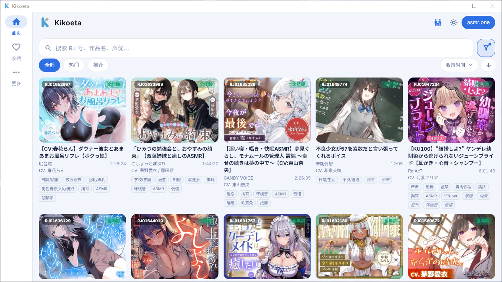 | 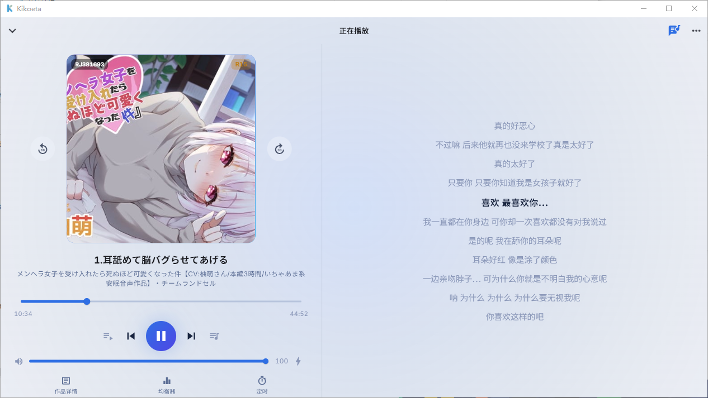 |

### Android

<table>
  <tr>
    <th width="33%">ホーム</th>
    <th width="33%">プレーヤーのジャケット表示</th>
    <th width="33%">プレーヤーの歌詞表示</th>
  </tr>
  <tr>
    <td>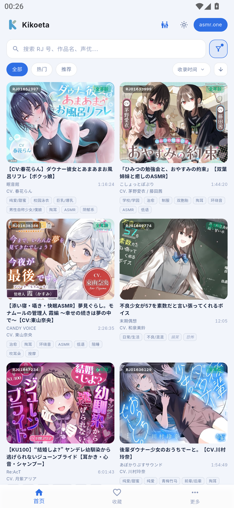</td>
    <td>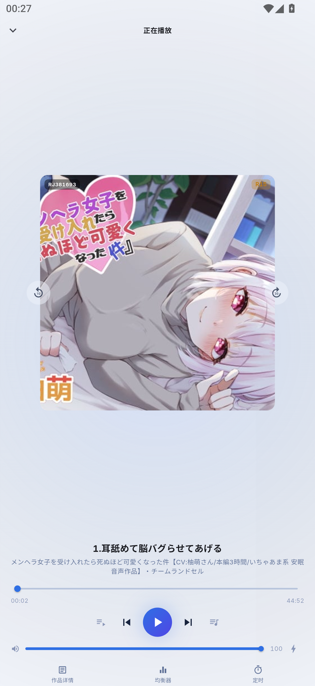</td>
    <td>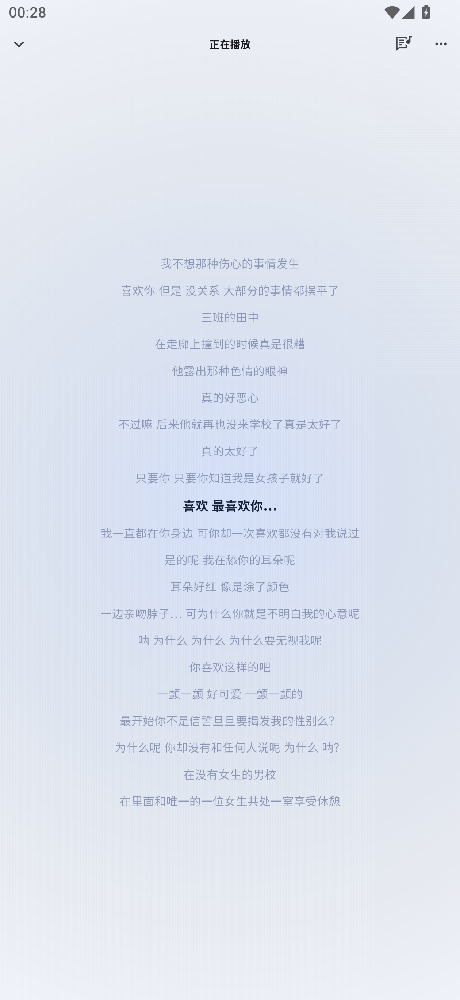</td>
  </tr>
</table>

#### 横向きプレーヤー（スマートフォン／ウルトラワイド画面のみ）

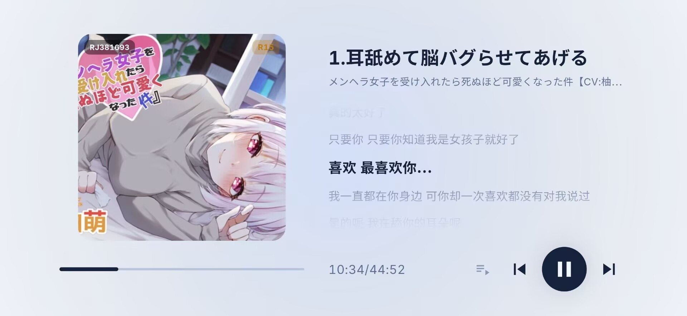

<details>
<summary>その他の画面：設定と再生ツール</summary>

<table>
  <tr>
    <th width="50%">ログインと自前サーバー</th>
    <th width="50%">HTTP プロキシ</th>
  </tr>
  <tr>
    <td>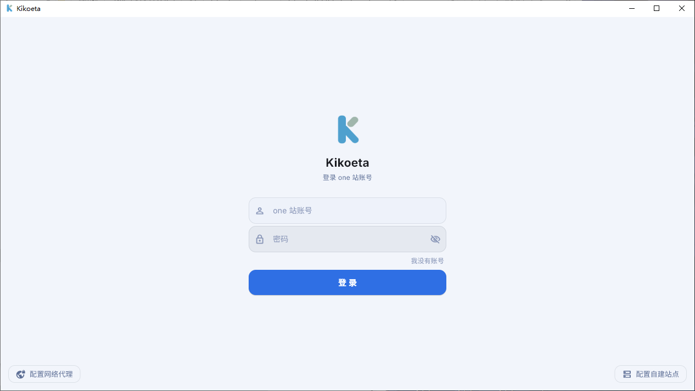</td>
    <td>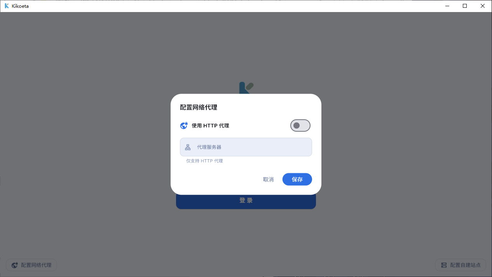</td>
  </tr>
  <tr>
    <th>10 バンドイコライザー</th>
    <th>スリープタイマー</th>
  </tr>
  <tr>
    <td>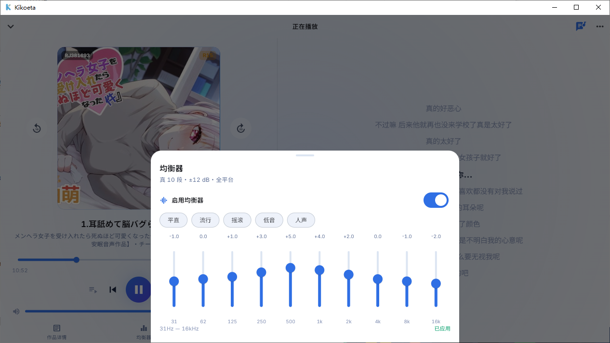</td>
    <td>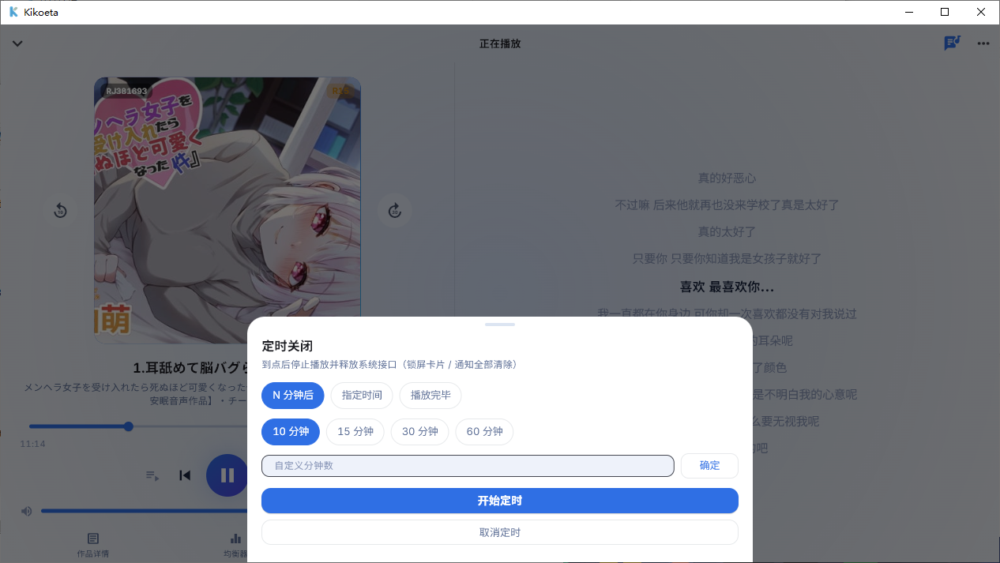</td>
  </tr>
</table>

<p align="center">
  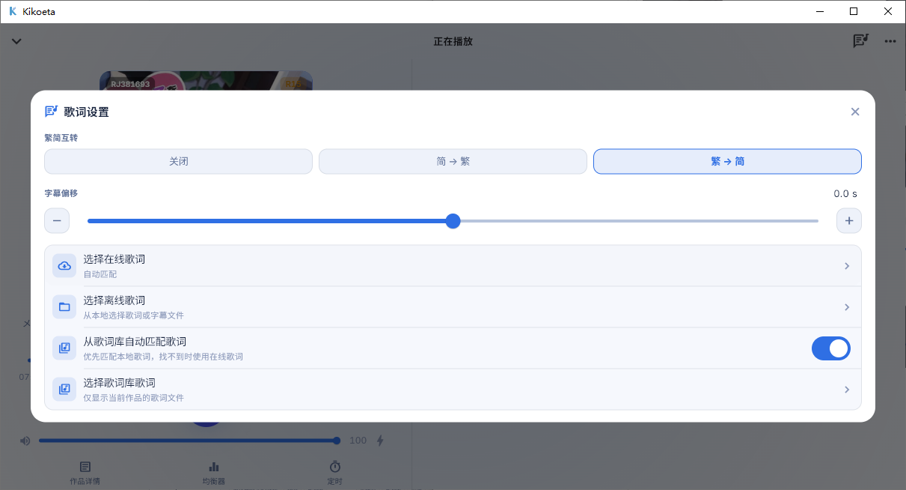<br>
  歌詞のクイック設定
</p>

</details>

## 機能

### 聴きたい作品を探す

- ページ単位の作品一覧と検索。タイトル、タグ、サークル、声優で検索でき、人気作品・おすすめ作品、並べ替え、年齢区分、字幕による絞り込みに対応しています。
- SFW モード、ブラックリスト、検索履歴に対応。RJ 番号をコピーして直接検索することもできます。
- asmr.one と自前の kikoeru-express サーバーを切り替え可能。アカウントでのログインと HTTP プロキシに対応しています。

### リスニングのための機能

- トラックツリー、優先する音声形式の指定、再生キュー、再生位置の記憶に対応。画像・テキスト・動画などの添付ファイルはプレビューや外部アプリで開けます。
- 再生モード、音量調整、2 段階のラウドネスブースト、10 バンドイコライザー、ミニプレーヤーを搭載。
- オンライン歌詞の自動マッチング、ローカル／オンライン歌詞の手動選択、表示タイミングの調整、簡体字・繁体字の変換に対応。横向きでは再生コントロールと歌詞を同時に表示できます。
- スリープタイマーはカウントダウン、時刻指定、再生終了時に対応。タイマー終了時、デスクトップ版はアプリを終了し、モバイル版は再生を停止します。

### ローカルデータと各プラットフォームの機能

- お気に入り、再生・検索履歴、プレイリスト、ブラックリスト、翻訳キャッシュ、再生位置をローカルに保存。
- 作品タイトルやトラック名を Google、Microsoft Edge、DeepL、OpenAI 互換の翻訳サービスで翻訳できます。
- 外部の [kikoeta-transl](https://github.com/chenflxs/kikoeta-transl) サービスに接続可能。作品詳細画面で音声を選択すると文字起こし・翻訳タスクを作成でき、完成した LRC ファイルはローカル歌詞ライブラリに自動で保存されます。
- Windows：位置のロック、文字サイズ・配色の変更ができるデスクトップ歌詞と、システムトレイからの操作。
- Android：ドラッグ・ロック可能なフローティング歌詞、ロック画面と通知のメディア操作、オーディオフォーカス、イヤホンを抜いた際の一時停止、バッテリー最適化の設定。

## 対応プラットフォーム

| プラットフォーム | 状況 | 配布形式 |
| --- | --- | --- |
| Windows x64 | 対応 | インストーラー |
| Android arm64-v8a | 対応 | APK |
| Linux / macOS | 対応予定 | - |
| iOS | 対応予定なし | [kikoeru-app](https://number17.online/docs/kikoeru-app) をご検討ください |

## はじめに

### ダウンロード

[GitHub Releases](https://github.com/chenflxs/kikoeta/releases) から、お使いのプラットフォーム向けの最新版をダウンロードしてください。

- Windows：インストーラーを実行します。
- Android：`arm64-v8a` の APK をダウンロードしてインストールします。

### 文字起こしと翻訳

この機能には、独立した [kikoeta-transl](https://github.com/chenflxs/kikoeta-transl) サービスが必要です。**Kikoeta には同梱されていない**ため、別途ダウンロード・配置・起動してください。Kikoeta は音声の送信、進捗の表示、生成された LRC ファイルの歌詞ライブラリへの保存を行います。

1. Windows で `kikoeta-transl` をダウンロードして起動し、**More → Transcription and translation** でローカル接続を選びます（既定のアドレス：`127.0.0.1:2370`）。別の場所で稼働するサービスの `IP／ドメイン:ポート` を入力することもできます。
2. Android ではネットワーク接続を選び、端末からサービスにアクセスできることを確認してください。
3. 作品詳細画面で処理する音声を選択し、右上のメニューから文字起こしと翻訳を選びます。接続をテストしてからタスクを開始してください。

接続情報は端末に保存されます。タスク完了後、作品の歌詞選択画面から自動インポートされた歌詞を利用できます。

### リモート歌詞ライブラリ

歌詞を PC やサーバーで一括管理したい場合は、[kikoeta-LLS](https://github.com/chenflxs/kikoeta-LLS) を利用できます。独立したリモート歌詞ライブラリで、Web 管理画面、歌詞ファイル／ZIP のインポート、kikoeta-transl が生成した歌詞の受信に対応しています。

1. `kikoeta-LLS` をダウンロードして起動し、ブラウザーで `http://server-address:2376` を開いて歌詞を管理します。インストールと配置の手順は同プロジェクトの [README](https://github.com/chenflxs/kikoeta-LLS#readme) を参照してください。
2. Kikoeta の **Lyrics library → Import → Remote library** で `http://server-address:2377` を入力します。同じ PC では `127.0.0.1`、スマートフォンから接続する場合は PC の LAN 内 IP アドレスを使います。
3. インポート時は先に作品インデックスを同期し、再生時のマッチングに応じて歌詞をダウンロードします。Transl から自動アップロードするには、Transl の出力ページで LLS のポート `2378` とアップロード用の認証情報を設定します。

各ポートの役割は **2376：管理、2377：読み取り、2378：アップロード**です。Kikoeta 内蔵の歌詞ライブラリ配信機能を有効にして、他の端末と共有することもできます。API の詳細は [ネットワークインターフェース](docs/%E7%BD%91%E7%BB%9C%E6%8E%A5%E5%8F%A3.md)（簡体字中国語）を参照してください。

## 開発

### ソースから実行

必要な環境：Flutter stable、Rust stable。Android のビルドには Android SDK、Windows のビルドには Flutter が指定する Visual Studio の「C++ によるデスクトップ開発」ツールチェーンも必要です。

```bash
cd app
flutter pub get

# Windows
flutter run -d windows

# Android（端末の接続またはエミュレーターの起動後）
flutter run
```

### リリースビルド

```bash
cd app

# Windows x64
flutter build windows --release

# Android arm64-v8a（Dart の難読化とシンボルファイルを含む）
flutter build apk --release --split-per-abi \
  --target-platform android-arm64 \
  --obfuscate --split-debug-info=build/symbols
```

### 技術構成

| コンポーネント | 技術 |
| --- | --- |
| UI | Flutter + Material 3 |
| コアロジック | Rust + flutter_rust_bridge v2 |
| 音声 | media_kit（libmpv ベース） |
| ローカルストレージ | SQLite（rusqlite） |
| Android のメディア操作 | Jetpack Media3 フォアグラウンドサービス |

### プロジェクト構成

```text
kikoeta/
├── app/                    Flutter アプリと Rust コア
│   ├── lib/                画面、サービス、状態管理
│   ├── rust/               API、翻訳、テキスト処理、プロキシ、SQLite ストレージ
│   ├── android/            Android ネイティブのメディア操作とフローティング歌詞
│   └── windows/            Windows デスクトップシェル
├── docs/                   ドキュメントとスクリーンショット
└── README*.md              各言語のプロジェクト説明
```

ソースの各ファイルについては [ファイル機能一覧](docs/文件功能索引.md)（簡体字中国語）を参照してください。

## 開発予定

- [ ] Linux・macOS クライアント
- [x] [kikoeta-transl](https://github.com/chenflxs/kikoeta-transl) による文字起こし・翻訳と歌詞ライブラリへのインポート
- [x] 音声のダウンロード ~~（*当面は対応予定なし*）~~
- [ ] ...

## 謝辞

- [Kikoeru](https://github.com/loli-ball/KikoeruRelease) の設計と実装を参考にしています。
- ASMR 音声作品のオンライン再生とダウンロードを長年提供している [asmr.one](https://asmr.one) に感謝します。
- 自前のストリーミング環境向けにオープンなバックエンドを提供する [kikoeru-express](https://github.com/Number178/kikoeru-express) と、そのメンテナーの皆様に感謝します。

## その他

本プロジェクトは初期テスト段階です。より安定したクロスプラットフォームクライアントをお探しの場合は、[KikoFlu](https://github.com/pa-jesusf/KikoFlu) もご検討ください。

## Star History

<a href="https://www.star-history.com/?repos=chenflxs%2Fkikoeta&type=date&legend=top-left">
  <picture>
    <source media="(prefers-color-scheme: dark)" srcset="https://api.star-history.com/chart?repos=chenflxs/kikoeta&type=date&theme=dark&legend=top-left&sealed_token=Xw9j97CVF4YrO7P_wRPptYeOdEvRh5X2FREFOLlWYl9UA42VMg33bjIef_WQl19FdXgvKk-BKkEZt6THPvd4MgH38rVpyLU01qdcU5ltJJrvUz9WywjvqHKJNEPu-DBJ15jjrVs_GxEZvI3snPF055YyqAD5g9aqsAEA_7rpiqv_6ZyeUiCEVEZ1crRC" />
    <source media="(prefers-color-scheme: light)" srcset="https://api.star-history.com/chart?repos=chenflxs/kikoeta&type=date&legend=top-left&sealed_token=Xw9j97CVF4YrO7P_wRPptYeOdEvRh5X2FREFOLlWYl9UA42VMg33bjIef_WQl19FdXgvKk-BKkEZt6THPvd4MgH38rVpyLU01qdcU5ltJJrvUz9WywjvqHKJNEPu-DBJ15jjrVs_GxEZvI3snPF055YyqAD5g9aqsAEA_7rpiqv_6ZyeUiCEVEZ1crRC" />
    
  </picture>
</a>

## ライセンス

[MIT](LICENSE) © 2026 chenflxs
