# Kikoeta

[简体中文](README.md) | [繁體中文](README.zh-Hant.md) | [English](README.en.md) | [日本語](README.ja.md) | [Русский](README.ru.md)

> Клиент для прослушивания ASMR. Поддерживает asmr.one, DLsite Play и собственные серверы на базе kikoeru-express. В Windows и Android доступны просмотр и воспроизведение произведений, тексты и субтитры, управление локальными данными.

[](https://github.com/chenflxs/kikoeta/releases) [](LICENSE) [](https://flutter.dev/) [](https://www.rust-lang.org/) [](https://github.com/chenflxs/kikoeta/releases)

> [!WARNING]
> Это неофициальный личный проект для обучения и личного прослушивания. API серверов и их доступность могут измениться в любой момент. Соблюдайте правила используемых сервисов.

[Скачать](#скачать) · [Возможности](#возможности) · [Транскрибация и перевод](#транскрибация-и-перевод) · [Удалённая библиотека текстов](#удалённая-библиотека-текстов) · [Разработка](#разработка)

## Скриншоты

### Настольная версия

| Главная | Проигрыватель |
| --- | --- |
| 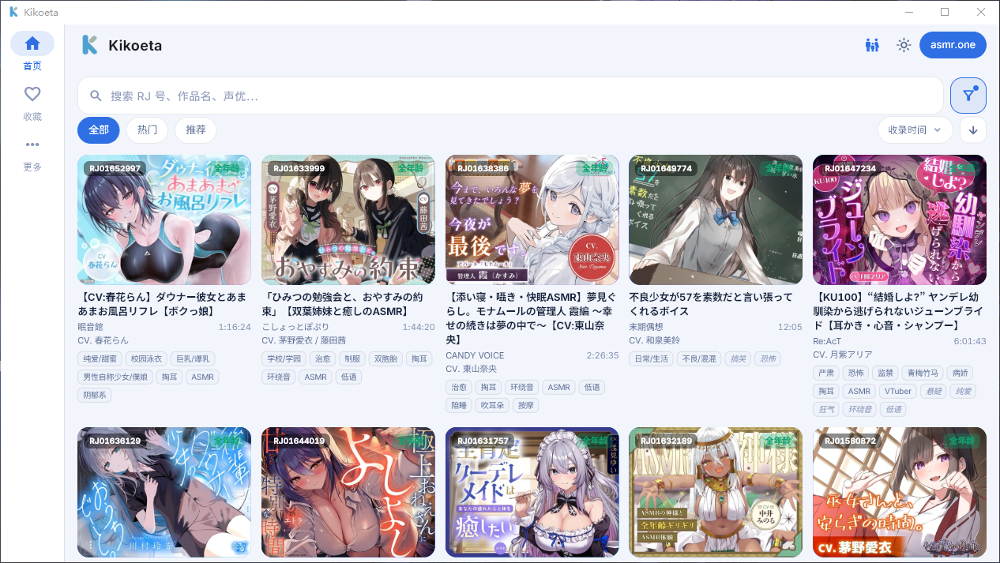 | 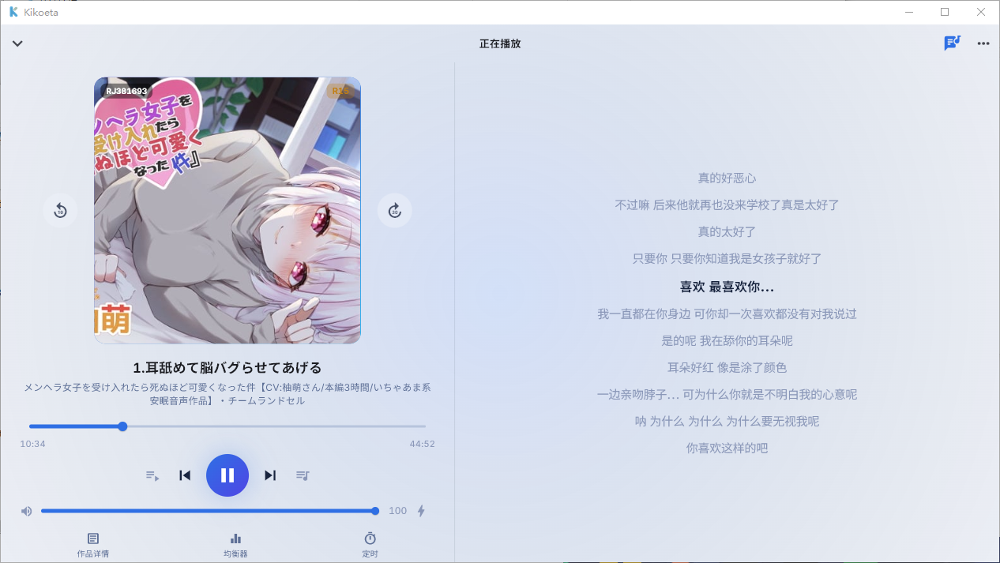 |

### Android

<table>
  <tr>
    <th width="33%">Главная</th>
    <th width="33%">Обложка в проигрывателе</th>
    <th width="33%">Текст в проигрывателе</th>
  </tr>
  <tr>
    <td>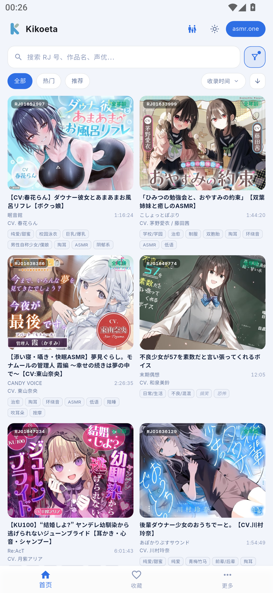</td>
    <td>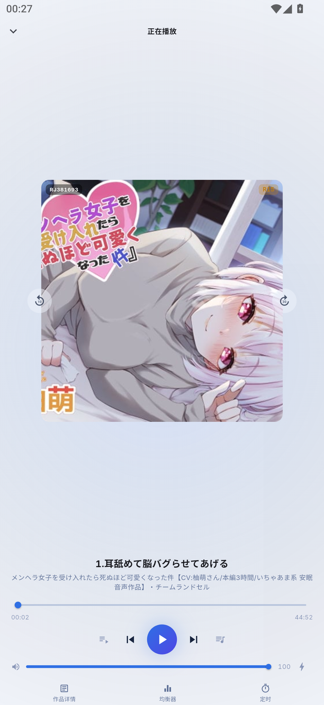</td>
    <td>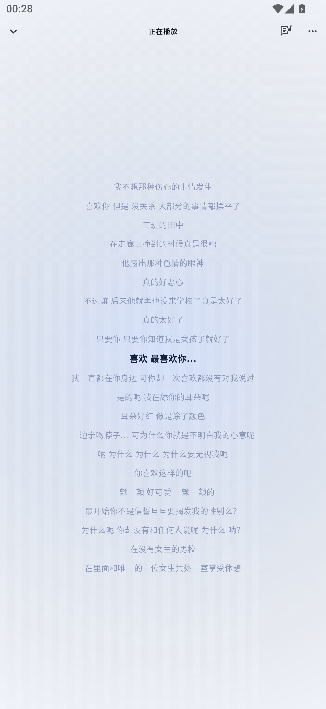</td>
  </tr>
</table>

#### Проигрыватель в альбомной ориентации (только телефоны и сверхширокие экраны)

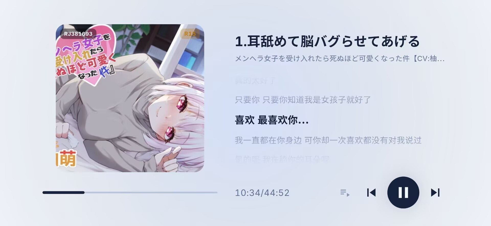

<details>
<summary>Другие скриншоты: настройки и инструменты воспроизведения</summary>

<table>
  <tr>
    <th width="50%">Вход в аккаунт и собственные серверы</th>
    <th width="50%">HTTP-прокси</th>
  </tr>
  <tr>
    <td>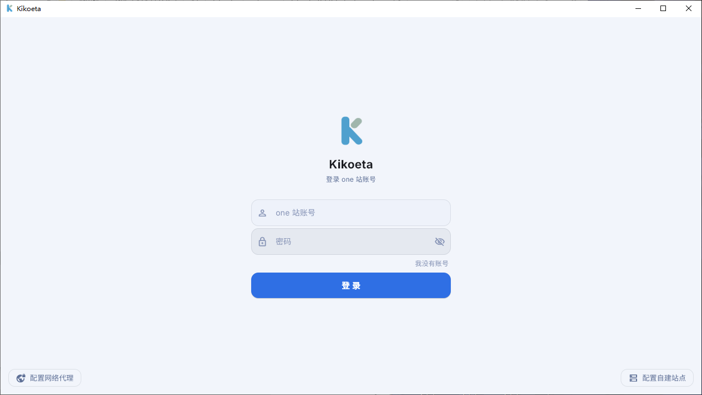</td>
    <td>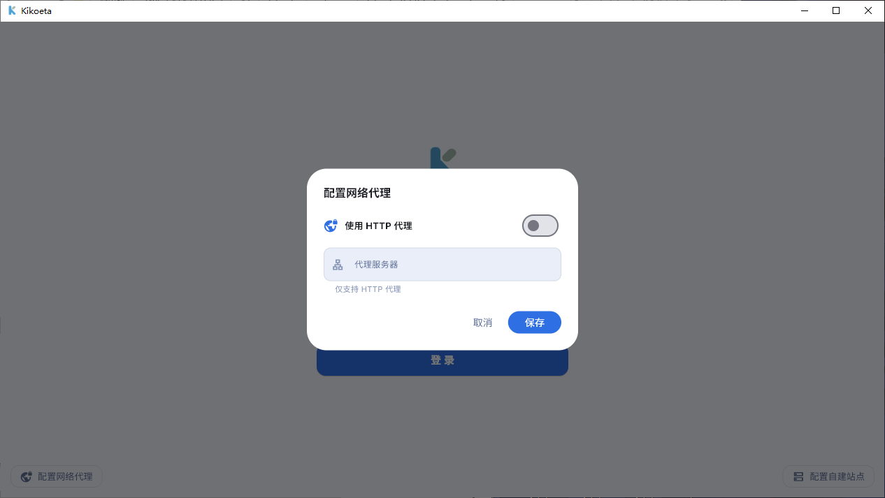</td>
  </tr>
  <tr>
    <th>10-полосный эквалайзер</th>
    <th>Таймер сна</th>
  </tr>
  <tr>
    <td>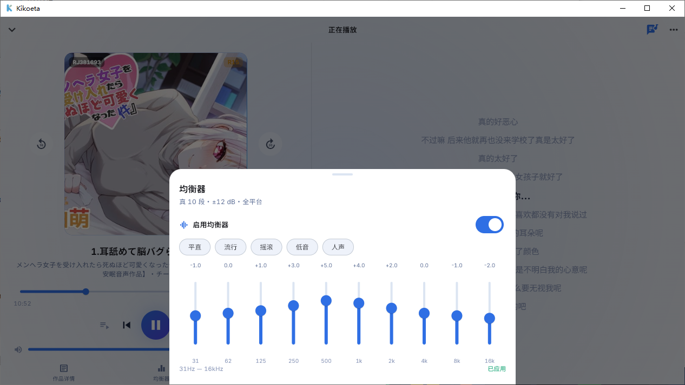</td>
    <td>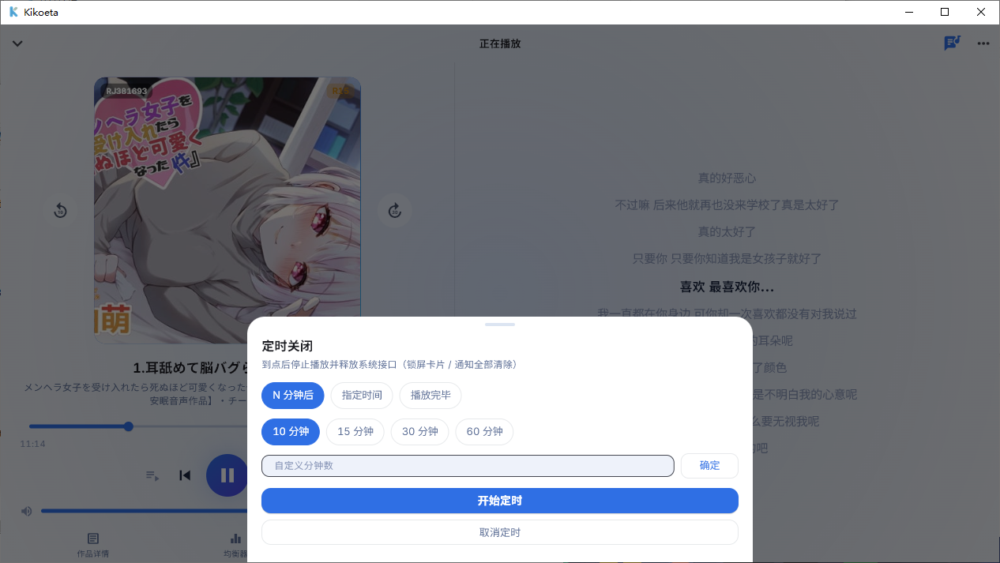</td>
  </tr>
</table>

<p align="center">
  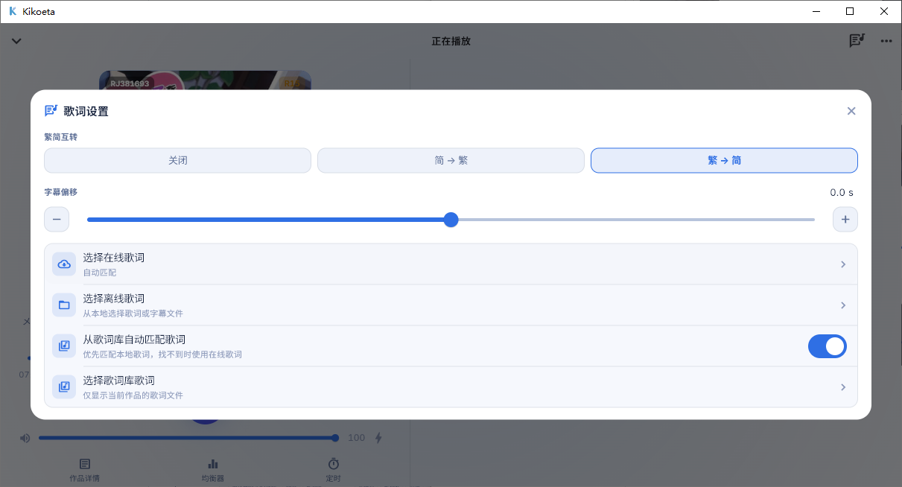<br>
  Быстрые настройки текста
</p>

</details>

## Возможности

### Поиск произведений

- Постраничный просмотр и поиск по названию, тегам, кружку или актёру озвучивания. Популярные и рекомендованные произведения, сортировка, фильтры по возрастному рейтингу и наличию субтитров.
- Режим SFW, чёрный список и история поиска. Можно скопировать RJ-номер и сразу начать поиск по нему.
- Переключение между asmr.one, DLsite Play и собственными серверами kikoeru-express, вход в аккаунт и поддержка HTTP-прокси.

### Всё для прослушивания

- Дерево треков, выбор предпочтительного аудиоформата, очередь воспроизведения и сохранение позиции. Изображения, текст, видео и другие вложения можно просматривать в приложении или открывать внешними средствами.
- Режимы воспроизведения, регулировка громкости, два уровня усиления громкости, 10-полосный эквалайзер и мини-проигрыватель.
- Автоматический подбор текстов из сети, ручной выбор локальных или онлайн-текстов, настройка временного сдвига и преобразование между упрощённой и традиционной китайской письменностью. В альбомной ориентации управление воспроизведением и текст могут отображаться одновременно.
- Таймер сна с обратным отсчётом, заданным временем или остановкой по завершении воспроизведения. По срабатывании таймера настольная версия закрывается, мобильная — останавливает воспроизведение.

### Локальные данные и возможности платформ

- Локальное хранение избранного, истории воспроизведения и поиска, плейлистов, чёрного списка, кэша переводов и позиции воспроизведения.
- Перевод названий произведений и треков через Google, Microsoft Edge, DeepL или сервисы, совместимые с OpenAI.
- Подключение к внешнему сервису [kikoeta-transl](https://github.com/chenflxs/kikoeta-transl). Выберите аудио на странице произведения, чтобы создать задачу транскрибации и перевода; готовые LRC-файлы автоматически сохраняются в локальную библиотеку текстов.
- Windows: текст поверх рабочего стола с фиксацией положения, настройкой размера шрифта и цветов, а также управление из системного трея.
- Android: плавающее окно текста с перемещением и фиксацией, управление с экрана блокировки и из уведомлений, обработка аудиофокуса, пауза при отключении наушников и настройки оптимизации батареи.

## Поддерживаемые платформы

| Платформа | Статус | Формат выпуска |
| --- | --- | --- |
| Windows x64 | Поддерживается | Установщик |
| Android arm64-v8a | Поддерживается | APK |
| Linux / macOS | Планируется | - |
| iOS | Не планируется | Рекомендуем [kikoeru-app](https://number17.online/docs/kikoeru-app) |

## Быстрый старт

### Скачать

Скачайте последнюю версию для своей платформы со страницы [GitHub Releases](https://github.com/chenflxs/kikoeta/releases).

- Windows: запустите установщик.
- Android: скачайте и установите APK для `arm64-v8a`.

### DLsite Play

На экране входа выберите **Войти через DLsite Play**. На главном экране можно нажать на название текущего сервера, выбрать **DLsite Play** и нажать **Применить**. После входа можно просматривать, искать и воспроизводить купленные произведения, а также управлять избранным и списками. Порядок входа с Cookie описан в [руководстве по входу в DLsite Play](docs/dlsite%20play%E7%99%BB%E5%BD%95%E6%8C%87%E5%BC%95.md) (на упрощённом китайском).

### Перевод готовых субтитров

В разделе **Настройки → Язык и перевод** выберите сервис перевода, исходный язык и язык перевода. Можно выбрать русский язык или ввести поддерживаемый сервисом код, например `fr` или `pt-BR`, через пункт **Другой язык**.

Во время воспроизведения откройте **Настройки текста → Перевести субтитры**. Субтитры текущего трека переводятся партиями. Можно следить за ходом перевода или отменить его. Перевод сохраняется в формате LRC в папке `RJ-номер-язык перевода/` библиотеки (например, `RJ123-en/` или `RJ123-zh-CN/`) с исходными временными метками и вложенными папками треков. Исходный файл сохраняется. В библиотеке переводы можно найти с помощью фильтра **TL**.

### Транскрибация и перевод

Для этой функции нужен отдельный сервис [kikoeta-transl](https://github.com/chenflxs/kikoeta-transl). Он **не входит в состав Kikoeta**: скачайте, разверните и запустите его самостоятельно. Kikoeta отправляет аудио произведения, отображает прогресс и сохраняет сгенерированные LRC-файлы в библиотеку текстов.

1. Скачайте и запустите `kikoeta-transl` в Windows, затем в разделе **More → Transcription and translation** выберите локальное подключение (адрес по умолчанию: `127.0.0.1:2370`). Также можно указать `IP/домен:порт` уже развёрнутого сервиса.
2. На Android выберите сетевое подключение и убедитесь, что сервис доступен с устройства.
3. Откройте страницу произведения, отметьте нужные аудиофайлы и выберите транскрибацию и перевод в меню справа вверху. Проверьте соединение и запустите задачу.

Настройки подключения сохраняются на устройстве. После завершения задачи автоматически импортированный текст можно выбрать в окне выбора текста для произведения.

### Удалённая библиотека текстов

Для централизованного хранения текстов на компьютере или сервере используйте [kikoeta-LLS](https://github.com/chenflxs/kikoeta-LLS). Это отдельная удалённая библиотека с веб-интерфейсом, импортом текстовых файлов и ZIP-архивов, а также приёмом текстов, созданных kikoeta-transl.

1. Скачайте и запустите `kikoeta-LLS`, затем откройте `http://server-address:2376` в браузере для управления текстами. Инструкции по установке и развёртыванию приведены в [README](https://github.com/chenflxs/kikoeta-LLS#readme) этого проекта.
2. В Kikoeta откройте **Lyrics library → Import → Remote library** и укажите `http://server-address:2377`. На том же компьютере можно использовать `127.0.0.1`; при подключении с телефона укажите локальный IP-адрес компьютера.
3. При импорте сначала синхронизируется индекс произведений; сами тексты загружаются при подборе во время воспроизведения. Для автоматической отправки из Transl укажите адрес LLS с портом `2378` и данные авторизации для загрузки на странице вывода Transl.

Назначение портов: **2376 — управление, 2377 — чтение, 2378 — загрузка на сервер**. Также можно включить встроенную в Kikoeta раздачу библиотеки текстов для других устройств. Подробности API см. в документе [Сетевые интерфейсы](docs/%E7%BD%91%E7%BB%9C%E6%8E%A5%E5%8F%A3.md) (на упрощённом китайском).

## Разработка

### Запуск из исходного кода

Требования: Flutter stable и Rust stable. Для сборки Android также нужен Android SDK, а для Windows — набор инструментов Visual Studio «Разработка классических приложений на C++», требуемый Flutter.

```bash
cd app
flutter pub get

# Windows
flutter run -d windows

# Android (сначала подключите устройство или запустите эмулятор)
flutter run
```

### Сборка релизной версии

```bash
cd app

# Windows x64
flutter build windows --release

# Android arm64-v8a (с обфускацией Dart и файлами символов)
flutter build apk --release --split-per-abi \
  --target-platform android-arm64 \
  --obfuscate --split-debug-info=build/symbols
```

### Стек технологий

| Компонент | Технология |
| --- | --- |
| Интерфейс | Flutter + Material 3 |
| Основная логика | Rust + flutter_rust_bridge v2 |
| Аудио | media_kit (на базе libmpv) |
| Локальное хранение | SQLite (rusqlite) |
| Управление медиа в Android | Сервис переднего плана Jetpack Media3 |

### Структура проекта

```text
kikoeta/
├── app/                    Приложение Flutter и ядро Rust
│   ├── lib/                Страницы, сервисы и управление состоянием
│   ├── rust/               API, перевод, обработка текста, прокси и SQLite
│   ├── android/            Нативное управление медиа и плавающее окно текста Android
│   └── windows/            Оболочка для Windows
├── docs/                   Документация и скриншоты
└── README*.md              Описание проекта на разных языках
```

Подробное описание назначения файлов см. в [Указателе исходных файлов](docs/文件功能索引.md) (на упрощённом китайском).

## Планы развития

- [ ] Клиенты для Linux и macOS
- [x] Транскрибация, перевод и импорт в библиотеку текстов через [kikoeta-transl](https://github.com/chenflxs/kikoeta-transl)
- [x] Скачивание аудио ~~( *не планируется в ближайшее время* )~~
- [ ] ...

## Благодарности

- При разработке использовались идеи дизайна и реализации [Kikoeru](https://github.com/loli-ball/KikoeruRelease).
- Спасибо [asmr.one](https://asmr.one) за многолетнее предоставление онлайн-прослушивания и скачивания ASMR-произведений.
- Спасибо [kikoeru-express](https://github.com/Number178/kikoeru-express) и его сопровождающим за открытый бэкенд для собственных стриминговых серверов.

## Другие клиенты

Проект находится на раннем этапе тестирования. Если вам нужен более стабильный кроссплатформенный клиент, обратите внимание на [KikoFlu](https://github.com/pa-jesusf/KikoFlu).

## Star History

<a href="https://www.star-history.com/?repos=chenflxs%2Fkikoeta&type=date&legend=top-left">
  <picture>
    <source media="(prefers-color-scheme: dark)" srcset="https://api.star-history.com/chart?repos=chenflxs/kikoeta&type=date&theme=dark&legend=top-left&sealed_token=Xw9j97CVF4YrO7P_wRPptYeOdEvRh5X2FREFOLlWYl9UA42VMg33bjIef_WQl19FdXgvKk-BKkEZt6THPvd4MgH38rVpyLU01qdcU5ltJJrvUz9WywjvqHKJNEPu-DBJ15jjrVs_GxEZvI3snPF055YyqAD5g9aqsAEA_7rpiqv_6ZyeUiCEVEZ1crRC" />
    <source media="(prefers-color-scheme: light)" srcset="https://api.star-history.com/chart?repos=chenflxs/kikoeta&type=date&legend=top-left&sealed_token=Xw9j97CVF4YrO7P_wRPptYeOdEvRh5X2FREFOLlWYl9UA42VMg33bjIef_WQl19FdXgvKk-BKkEZt6THPvd4MgH38rVpyLU01qdcU5ltJJrvUz9WywjvqHKJNEPu-DBJ15jjrVs_GxEZvI3snPF055YyqAD5g9aqsAEA_7rpiqv_6ZyeUiCEVEZ1crRC" />
    
  </picture>
</a>

## Лицензия

[MIT](LICENSE) © 2026 chenflxs
