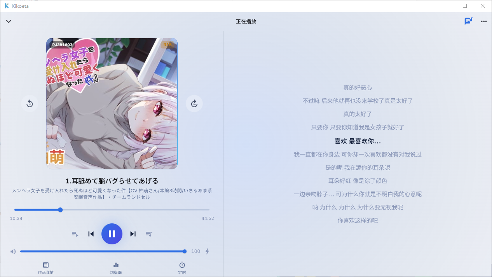
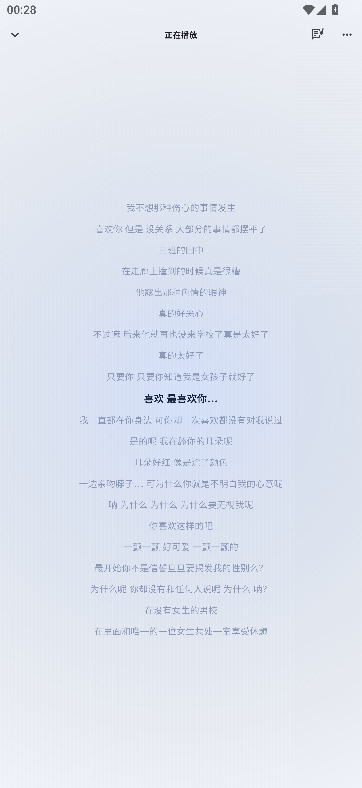
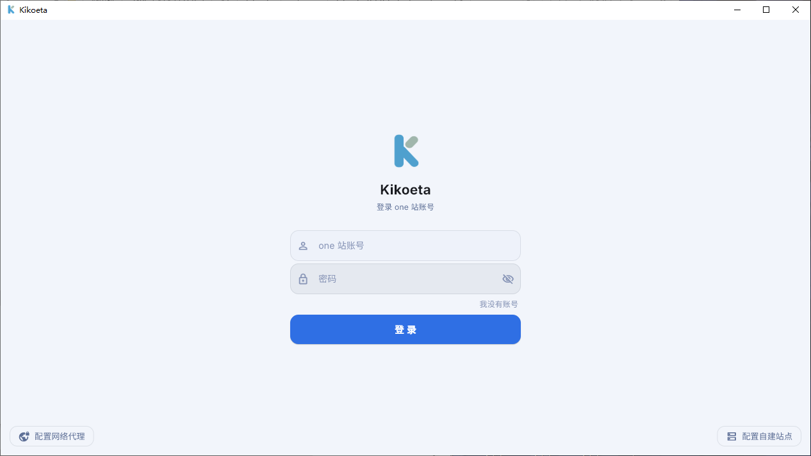
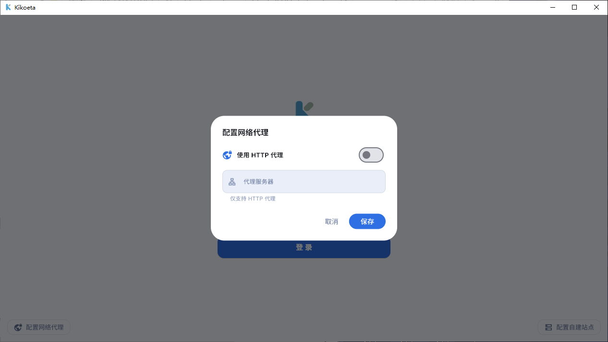
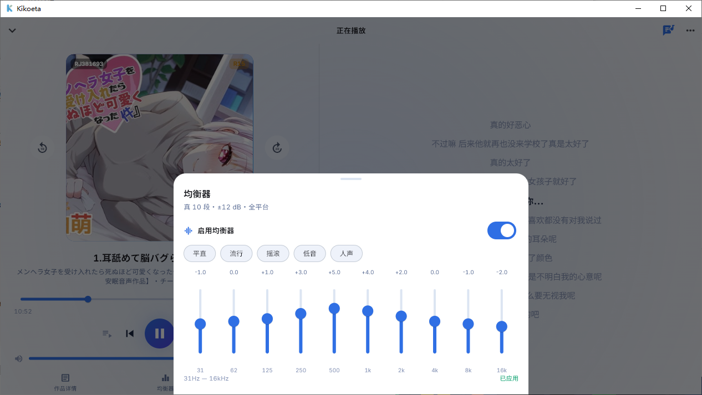
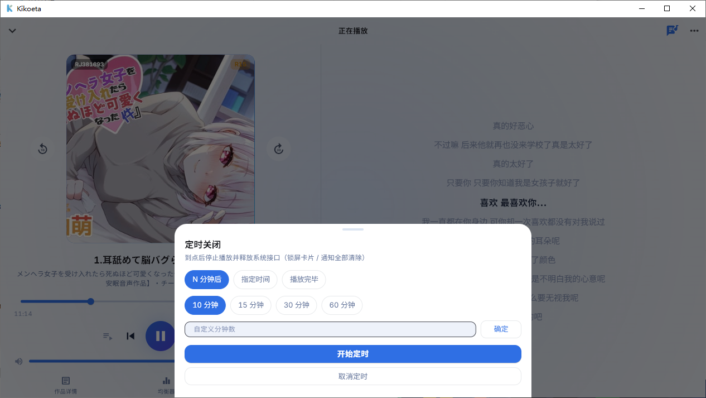
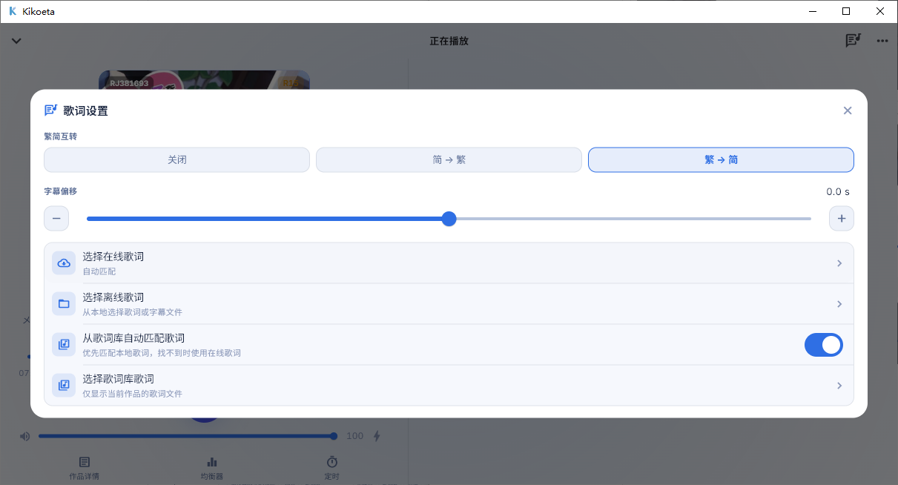

# Kikoeta

[简体中文](README.md) | [繁體中文](README.zh-Hant.md) | [English](README.en.md) | [日本語](README.ja.md) | [Русский](README.ru.md)

> 專為 ASMR 音聲設計的本機聆聽用戶端。支援 asmr.one 與基於 kikoeru-express 的自架站點，在 Windows 和 Android 上提供瀏覽、播放、歌詞與本機資料管理體驗。

[](https://github.com/chenflxs/kikoeta/releases) [](LICENSE) [](https://flutter.dev/) [](https://www.rust-lang.org/) [](https://github.com/chenflxs/kikoeta/releases)

> [!WARNING]
> 本專案為非官方個人專案，僅供學習與個人聆聽使用。伺服器 API 及其可用性可能隨時變動，請遵守相關服務的使用規則。

[下載使用](#下載使用) · [功能](#功能) · [聽寫翻譯](#使用聽寫翻譯) · [遠端歌詞庫](#使用遠端歌詞庫) · [開發說明](#開發說明)

## 介面預覽

### 桌面版

| 首頁 | 播放器 |
| --- | --- |
|  |  |

### Android

<table>
  <tr>
    <th width="33%">首頁</th>
    <th width="33%">播放器封面</th>
    <th width="33%">播放器歌詞</th>
  </tr>
  <tr>
    <td></td>
    <td></td>
    <td></td>
  </tr>
</table>

#### 橫向播放器（僅手機／超寬螢幕）


<details>
<summary>更多截圖：設定與播放工具</summary>

<table>
  <tr>
    <th width="50%">帳號登入與自架站點</th>
    <th width="50%">HTTP 網路代理</th>
  </tr>
  <tr>
    <td></td>
    <td></td>
  </tr>
  <tr>
    <th>10 段等化器</th>
    <th>睡眠計時器</th>
  </tr>
  <tr>
    <td></td>
    <td></td>
  </tr>
</table>

<p align="center">
  <br>
  歌詞快捷設定
</p>

</details>

## 功能

### 找到想聽的作品

- 分頁作品列表與搜尋：支援標題、標籤、社團、聲優搜尋，以及熱門、推薦、排序、年齡分級和字幕篩選。
- 更清爽的瀏覽體驗：支援 SFW 模式、黑名單篩選和搜尋紀錄；複製 RJ 編號後可直接搜尋。
- 多伺服器：可在 asmr.one 與自架 kikoeru-express 站點間切換；支援帳號登入和 HTTP 代理。

### 專為聆聽設計

- 曲目樹支援音訊格式偏好、播放佇列、進度記憶，以及圖片、文字、影片等附件的預覽或外部開啟。
- 播放器提供播放模式、音量、兩級響度增強、10 段等化器與迷你播放器。
- 歌詞支援線上自動比對、手動選擇本機／線上歌詞、時間偏移和簡繁轉換；橫向顯示時可同時查看播放控制與歌詞。
- 睡眠計時器支援倒數、指定時間與播放完畢；桌面版到時結束程式，行動版停止播放。

### 本機資料與平台體驗

- 在本機儲存收藏、播放／搜尋紀錄、播放清單、黑名單、翻譯快取與播放進度。
- 標題和曲目可使用 Google、Microsoft Edge、DeepL 或 OpenAI 相容翻譯服務。
- 支援連接外部 [kikoeta-transl](https://github.com/chenflxs/kikoeta-transl) 服務：從作品詳細頁選擇音訊即可建立聽寫翻譯任務，完成後將產生的 LRC 自動寫入本機歌詞庫。
- Windows 提供可鎖定、可調整字級與配色的桌面歌詞，以及系統匣控制。
- Android 提供可拖曳／鎖定的懸浮歌詞、鎖定畫面和通知列媒體控制、音訊焦點、拔除耳機時暫停與電池最佳化設定。

## 支援平台

| 平台 | 狀態 | 發佈檔案 |
| --- | --- | --- |
| Windows x64 | 支援 | 安裝程式 |
| Android arm64-v8a | 支援 | APK |
| Linux / macOS | 規劃中 | - |
| iOS | 暫無計畫 | 建議使用 [kikoeru-app](https://number17.online/docs/kikoeru-app) |

## 快速開始

### 下載使用

從 [GitHub Releases](https://github.com/chenflxs/kikoeta/releases) 下載對應平台的最新版本。

- Windows：執行安裝程式完成安裝。
- Android：下載並安裝 `arm64-v8a` APK。

### 使用聽寫翻譯

聽寫翻譯依賴獨立的 [kikoeta-transl](https://github.com/chenflxs/kikoeta-transl) 服務；該服務**不隨 Kikoeta 提供**，請自行下載、部署並啟動。Kikoeta 僅負責提交作品音訊、顯示進度，並將產生的 LRC 儲存到歌詞庫。

1. 在 Windows 上下載並啟動 `kikoeta-transl`，然後在「更多 → 聽寫翻譯」中選擇「本機連線」（預設位址為 `127.0.0.1:2370`）；也可填入已部署服務的 `IP／網域:連接埠`。
2. 在 Android 上請選擇網路連線，並確保裝置能存取該服務。
3. 開啟作品詳細頁，勾選要處理的音訊，在右上角「更多」中選擇「聽寫翻譯」，測試連線後開始任務。

服務連線資訊會儲存在本機。任務完成後，回到作品的歌詞選擇器即可使用自動匯入的歌詞。

### 使用遠端歌詞庫

想將歌詞放在電腦或伺服器上統一管理，可以使用 [kikoeta-LLS](https://github.com/chenflxs/kikoeta-LLS)。它是獨立的遠端歌詞庫，支援網頁管理、歌詞檔案／ZIP 匯入，也能接收 kikoeta-transl 產生的歌詞。

1. 下載並啟動 `kikoeta-LLS`，在瀏覽器開啟 `http://伺服器位址:2376` 管理歌詞；安裝和部署方法請見它的 [README](https://github.com/chenflxs/kikoeta-LLS#readme)。
2. 在 Kikoeta 的「歌詞庫 → 匯入 → 遠端庫」中填入 `http://伺服器位址:2377`。同一台電腦可使用 `127.0.0.1`，手機連線時填入電腦的區域網路 IP。
3. 匯入後會先同步作品索引，播放比對時再下載歌詞。若要讓 Transl 自動上傳，請在 Transl 的「輸出」頁設定 LLS 的 `2378` 連接埠和上傳憑證。

三個連接埠分別為：**2376 管理、2377 讀取、2378 上傳**。也可以直接開啟 Kikoeta 內建的歌詞庫廣播，供其他裝置使用。介面細節請見 [網路介面](docs/%E7%BD%91%E7%BB%9C%E6%8E%A5%E5%8F%A3.md)（簡體中文）。

## 開發說明

### 從原始碼執行

環境需求：Flutter stable、Rust stable；建置 Android 還需 Android SDK，建置 Windows 還需 Flutter 官方要求的 Visual Studio C++ 桌面開發工具鏈。

```bash
cd app
flutter pub get

# Windows
flutter run -d windows

# Android（連接裝置或啟動模擬器後）
flutter run
```

### 建置發佈版

```bash
cd app

# Windows x64
flutter build windows --release

# Android arm64-v8a（含 Dart 混淆與符號檔案）
flutter build apk --release --split-per-abi \
  --target-platform android-arm64 \
  --obfuscate --split-debug-info=build/symbols
```

### 技術架構

| 模組 | 方案 |
| --- | --- |
| UI | Flutter + Material 3 |
| 核心邏輯 | Rust + flutter_rust_bridge v2 |
| 音訊 | media_kit（基於 libmpv） |
| 本機儲存 | SQLite（rusqlite） |
| Android 媒體控制 | Jetpack Media3 前景服務 |

### 專案結構

```text
kikoeta/
├── app/                    Flutter 應用程式與 Rust 核心
│   ├── lib/                頁面、服務與狀態管理
│   ├── rust/               API、翻譯、文字處理、代理與 SQLite 儲存
│   ├── android/            Android 原生媒體控制與懸浮歌詞
│   └── windows/            Windows 桌面外殼
├── docs/                   文件與介面截圖
└── README*.md              各語言版本的專案說明
```

詳細原始碼位置請見 [檔案功能索引](docs/文件功能索引.md)（簡體中文）。

## 開發計畫

- [ ] Linux 與 macOS 用戶端
- [x] 基於 [kikoeta-transl](https://github.com/chenflxs/kikoeta-transl) 的聽寫翻譯與歌詞庫匯入
- [x] 音聲下載功能 ~~（*短期內無計畫*）~~
- [ ] ...

## 致謝

- 本專案參考了 [Kikoeru](https://github.com/loli-ball/KikoeruRelease) 的設計與實作。
- 感謝 [asmr.one](https://asmr.one) 長期提供音聲作品的線上聆聽與下載服務。
- 感謝 [kikoeru-express](https://github.com/Number178/kikoeru-express) 及維護者，為自架串流媒體生態提供開放後端。

## 其他

本專案處於早期測試階段；如需更穩定的跨平台用戶端，可參考 [KikoFlu](https://github.com/pa-jesusf/KikoFlu)。

## Star History

<a href="https://www.star-history.com/?repos=chenflxs%2Fkikoeta&type=date&legend=top-left">
  <picture>
    <source media="(prefers-color-scheme: dark)" srcset="https://api.star-history.com/chart?repos=chenflxs/kikoeta&type=date&theme=dark&legend=top-left&sealed_token=Xw9j97CVF4YrO7P_wRPptYeOdEvRh5X2FREFOLlWYl9UA42VMg33bjIef_WQl19FdXgvKk-BKkEZt6THPvd4MgH38rVpyLU01qdcU5ltJJrvUz9WywjvqHKJNEPu-DBJ15jjrVs_GxEZvI3snPF055YyqAD5g9aqsAEA_7rpiqv_6ZyeUiCEVEZ1crRC" />
    <source media="(prefers-color-scheme: light)" srcset="https://api.star-history.com/chart?repos=chenflxs/kikoeta&type=date&legend=top-left&sealed_token=Xw9j97CVF4YrO7P_wRPptYeOdEvRh5X2FREFOLlWYl9UA42VMg33bjIef_WQl19FdXgvKk-BKkEZt6THPvd4MgH38rVpyLU01qdcU5ltJJrvUz9WywjvqHKJNEPu-DBJ15jjrVs_GxEZvI3snPF055YyqAD5g9aqsAEA_7rpiqv_6ZyeUiCEVEZ1crRC" />
    
  </picture>
</a>

## 授權

[MIT](LICENSE) © 2026 chenflxs
